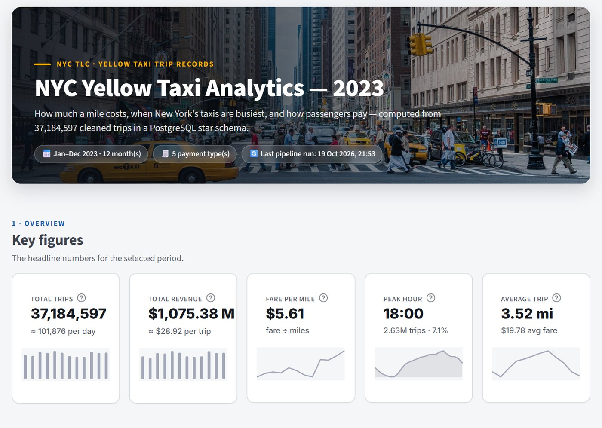
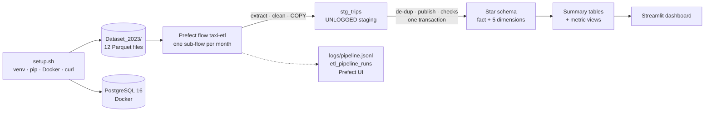
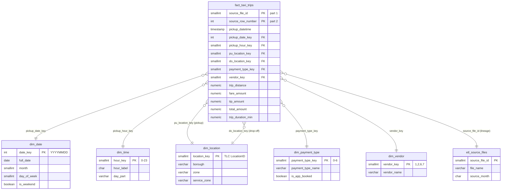
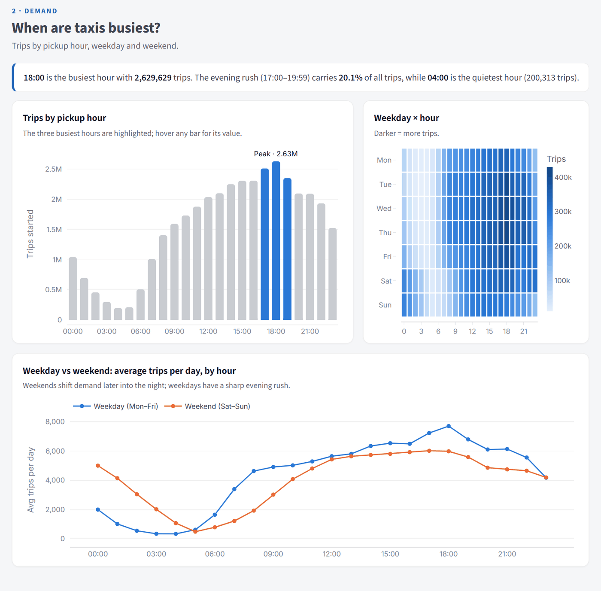
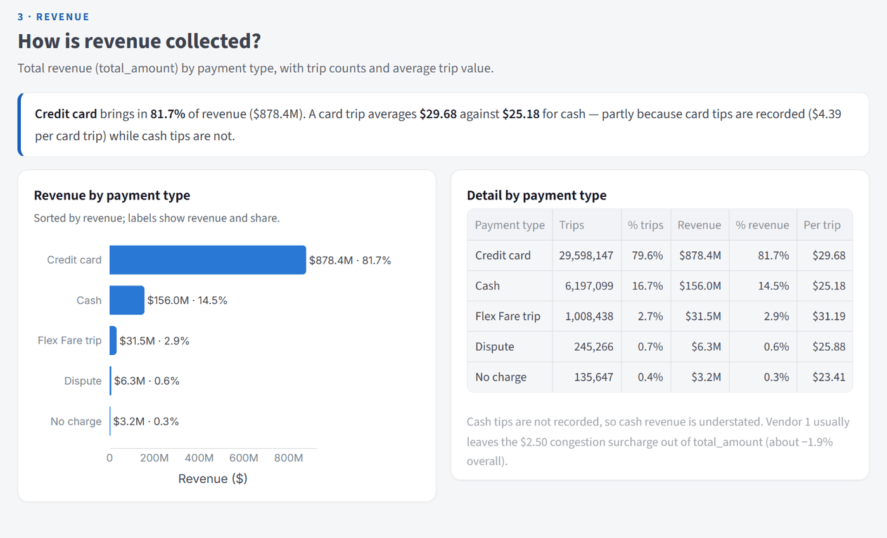
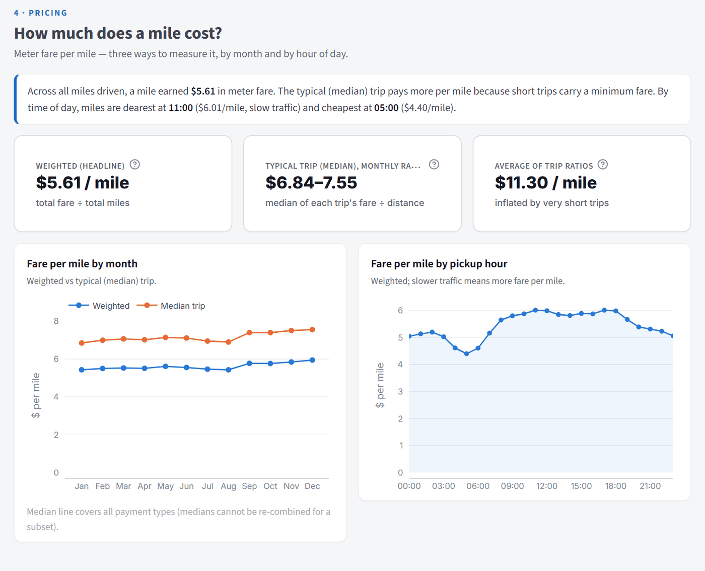
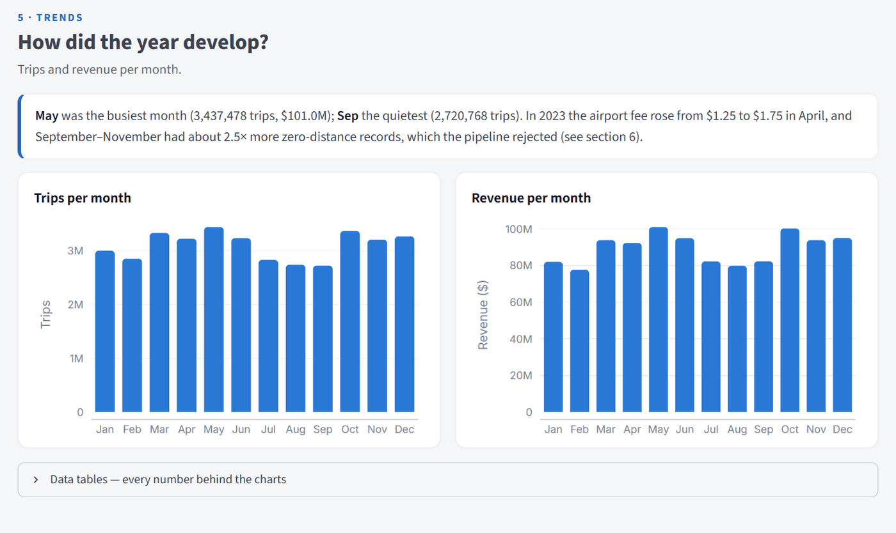
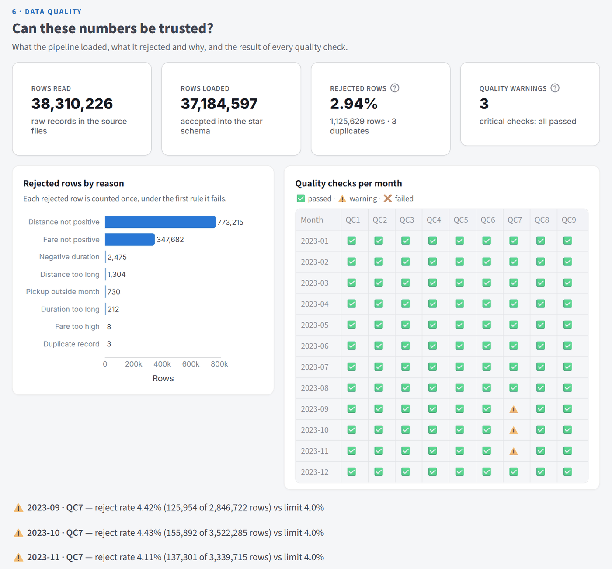

# NYC Yellow Taxi — Batch ETL, Star Schema & Dashboard

A local, automated batch pipeline that downloads NYC TLC yellow-taxi trip data, cleans it,
loads it into a **PostgreSQL star schema**, and shows three business metrics on a
**Streamlit** dashboard. Orchestrated with **Prefect**; every run is logged, checked and recorded.



**Dataset:** all 12 months of 2023 — 38,310,226 raw trips → **37,184,597 loaded** (2.94% rejected by cleaning rules).

| Metric | Result (2023) |
|---|---|
| Average fare per mile (weighted: total fare ÷ total miles) | **$5.61** |
| Peak hour for taxi rides | **18:00** (2,629,629 trips), then 17:00 and 19:00 |
| Total revenue by payment type | **$1,075.38 M** total — credit card 81.7%, cash 14.5%, Flex Fare 2.9% |

---

## Contents
1. [Architecture](#1-architecture)
2. [Quick start](#2-quick-start)
3. [Project structure](#3-project-structure)
4. [Dataset choice](#4-dataset-choice)
5. [Star schema](#5-star-schema)
6. [The pipeline](#6-the-pipeline)
7. [Metrics & dashboard](#7-metrics--dashboard)
8. [Logging, monitoring & error handling](#8-logging-monitoring--error-handling)
9. [Testing](#9-testing)
10. [Configuration](#10-configuration)
11. [Assumptions](#11-assumptions)
12. [Demo script](#12-demo-script)
13. [Troubleshooting](#13-troubleshooting)
14. [Measured performance](#14-measured-performance)

---

## 1. Architecture



| Layer | Tool | Why |
|---|---|---|
| Setup | Bash (`setup.sh`), `curl` | One command prepares everything; safe to re-run |
| Orchestration | **Prefect 3** (local server) | Easiest to learn, runs natively on Windows, real retries/hooks/UI |
| ETL | Python 3.10, pyarrow, pandas | Batch reading of Parquet, vectorised cleaning |
| Database | **PostgreSQL 16** in Docker | Required by the brief; partitions, transactions, `COPY` |
| Dashboard | **Streamlit** + Plotly | One-page app in pure Python |
| Tests | pytest (+ Streamlit AppTest) | 78 tests, unit + integration |

---

## 2. Quick start

**Prerequisites:** Windows with **Git Bash** (or Linux/macOS Bash), **Python 3.10+**, **Docker Desktop running**, internet for downloads.

```bash
# 1. Prepare everything: venv, packages, PostgreSQL in Docker, schema, data files, zone lookup
bash setup.sh                       # safe to re-run; skips what is done (dev: --months 2023-01,2023-02)

# 2. (optional, recommended) Prefect UI with run history — keep it running in its own terminal
bash scripts/start_prefect_server.sh            # http://127.0.0.1:4200

# 3. Run the pipeline (all months in .env; ~27 min for 12 months, ~2 min per month)
.venv/Scripts/python -m pipeline.flows          # Linux/macOS: .venv/bin/python
.venv/Scripts/python -m pipeline.flows --months 2023-01,2023-02   # smaller run

# 4. Open the dashboard                          # http://localhost:8501
.venv/Scripts/streamlit run dashboard/app.py

# 5. Run the tests (~1.5 min; database-free subset: -m "not integration", ~4 s)
.venv/Scripts/python -m pytest -q
```

> **Windows Command Prompt instead of Git Bash?** `setup.sh` needs Bash, but everything else
> works in cmd after `.venv\Scripts\activate.bat` (then `python -m pipeline.flows`, `streamlit run dashboard/app.py`, …).

---

## 3. Project structure

```
setup.sh                    One-command setup (venv, pip, Docker DB, schema + views, curl downloads)
docker-compose.yml          PostgreSQL 16 service (named volume, health check, bulk-load tuning)
.env.example                All settings (copied to .env by setup.sh)
requirements.txt            Pinned Python dependencies
sql/schema.sql              Star schema, summary tables, staging, run/quality tables (idempotent)
sql/views.sql               Metric views read by the dashboard
sql/metrics.sql             The 3 metrics computed from the fact table + reconciliation with the views
pipeline/
  config.py                 Settings from .env, target schema, valid codes, thresholds
  extract.py                Validate a Parquet file; normalise names/types; read in batches
  transform.py              Cleaning rules R1-R13; star-schema keys; warning counts
  load.py                   Dimensions, staging COPY, all-or-nothing monthly publish
  quality.py                Critical checks QC1-QC6 (pre-commit) and warnings QC7-QC9
  flows.py                  Prefect flows/tasks, retries, failure hooks, CLI, --serve schedule
  logging_config.py         Structured JSON logging with run context
  db.py, exceptions.py      Connections + fast COPY; custom error types
  dry_run.py                Extract + transform whole months without the database
dashboard/app.py            Single-page Streamlit dashboard (Inter font, design tokens, cover photo)
public/image.png            Cover photo shown in the dashboard header
scripts/inspect_data.py     Re-runnable profile of the raw files
scripts/start_prefect_server.sh   Local Prefect server (state in .prefect/)
tests/                      78 tests (unit + integration on a throw-away taxi_test database)
ASSIGNMENT_1_PLAN.md        Full design document: analysis, decisions, measurements
docs/                       Project report and study guide (Word), dashboard screenshots (docs/images/)
```

Generated at run time (git-ignored): `.venv/`, `.env`, `Dataset_*/`, `reference/`, `data/rejected/`, `logs/`, `.prefect/`.

---

## 4. Dataset choice

2023 (12 months) was chosen:

| | 2023 (chosen) |
|---|---|---|
| Coverage | Complete calendar year |
| Rows rejected by cleaning | 2.94% |
| True duplicates | 3 rows all year |
| Unusable timestamps | none |
| Undocumented columns | none |

All 12 months give real seasonality and trends (e.g. the April airport-fee rise, a zero-distance spike in Sep–Nov).

Data definitions follow the official **TLC Data Dictionary – Yellow Taxi Trip Records (March 18, 2025)**.

---

## 5. Star schema

**Grain:** one row in `fact_taxi_trips` = one accepted, de-duplicated trip record from a monthly file.



- **Dimensions:** `dim_date` (1,461 days, 2023–2026), `dim_time` (24 hours with day parts), `dim_location`
  (265 TLC zones — a *role-playing* dimension used for pickup **and** drop-off), `dim_payment_type` (7 codes),
  `dim_vendor` (4 vendors). Small official code lists use the TLC code as the key; dates use `YYYYMMDD`.
- **Fact:** money as `NUMERIC(10,2)` (exact); CHECK constraints for valid ranges; columns ordered by size to avoid padding.
- **Primary key `(source_file_id, source_row_number)`:** identifies every trip and makes a second copy impossible.
- **Partitioned by source file** (one partition per month): a reload empties only that partition — no table growth.
- **BRIN index** on the date key (kilobytes instead of ~300 MB for a normal index).
- **Summary tables** `agg_trips_daily_hourly` (day × hour × payment type, ~61k rows/year) and
  `agg_monthly_fare_stats` (medians) are rebuilt with each month, so the dashboard never scans 37 M rows.
- **Operational tables:** `etl_pipeline_runs`, `etl_rejected_summary`, `etl_quality_results`, `etl_source_files`.

---

## 6. The pipeline

`python -m pipeline.flows` runs the parent flow **`taxi-etl`**, which runs one **`process-<month>`** sub-flow per month:

| # | Prefect task | What it does |
|---|---|---|
| 1 | `start-run` | Insert a RUNNING row in `etl_pipeline_runs` (first, so even a missing file is recorded) |
| 2 | `validate-inputs` | File exists, readable Parquet, required columns present |
| 3 | `load-dimensions`, `register-file` | Upsert the 265 zones; register the file and create its fact partition |
| 4 | `stage-month` | Read in 250k-row batches → normalise schema → rules R1–R13 → star keys → `COPY` to staging |
| 5 | `publish-month` | **One transaction:** de-duplicate (rule D1) → replace the month's partition → rebuild summaries → **critical checks QC1–QC6** → `COMMIT` (or `ROLLBACK`, keeping the old data) |
| 6 | `run-warning-checks` | QC7–QC9: logged + stored, never block |
| 7 | `finish-run` | SUCCESS with counts and duration |

**Cleaning rules** (a row is counted once, under the first rule it fails — so `read = loaded + rejected` always holds):

| Rule | Reject when | 2023 rows |
|---|---|---|
| R1 | required field missing | 0 |
| R2 | pickup outside the file's month (incl. 2001/2008 dates) | 730 |
| R3 / R4 | drop-off before pickup / duration > 24 h | 2,475 / 212 |
| R5 / R6 | distance ≤ 0 / > 100 miles | 773,215 / 1,304 |
| R7 / R8 | fare ≤ 0 / fare > $1,000 (max seen: $386,983) | 347,682 / 8 |
| R9–R13 | total ≤ 0, unknown zone / payment type / vendor, impossible amount | 0 |
| D1 | duplicate trip (same vendor, times, zones, distance, fare) — keep the most complete copy | 3 |

Kept but counted as warnings: zero-duration trips, passenger count 0 or missing, rate code 99,
`total_amount` ≠ sum of its parts (Vendor 1 leaves the $2.50 congestion surcharge out of the total; −1.9% overall).

**Re-runs are safe (idempotent):** the month is replaced inside one transaction, the primary key refuses a
second copy of any source row, and dimensions are upserted. Reloading a month gives identical totals and size.

**Schema drift handled:** January 2023 uses `airport_fee` and double columns, Feb–Dec use `Airport_fee` and
integers; 2026 adds `cbd_congestion_fee` and `request_source`. Columns are lower-cased and cast to one target schema;
missing optional columns become NULL.

**Fast loading:** pyarrow → CSV → PostgreSQL `COPY`; foreign keys are checked in one set-based query (QC3)
before commit instead of row by row (`FAST_FK_LOAD=true`, 354 s → 48 s per month insert) — the constraints stay declared
and a bad key still rolls the month back.

**Orchestration extras:** retries only for "database unreachable" (3×, 10 s apart); a failed month does not stop the
others, and the parent flow then ends Failed; `python -m pipeline.flows --serve` registers a **scheduled deployment**
(`SCHEDULE_CRON`, default 06:00 on the 2nd of each month).

---

## 7. Metrics & dashboard

| Metric | Definition | View | 2023 |
|---|---|---|---|
| Average fare per mile | **SUM(fare) ÷ SUM(distance)** — what one mile earns. Shown beside it: median trip ($6.84–7.55 per month) and the simple average of per-trip ratios ($11.30, inflated by very short trips) | `vw_fare_per_mile`, `vw_fare_per_mile_monthly` | **$5.61** |
| Peak hours | Trips per **pickup** hour, ranked | `vw_trips_by_hour` | **18:00**, 17:00, 19:00; quietest 04:00 |
| Revenue by payment type | SUM(`total_amount`) per type (fare and tips shown too) | `vw_revenue_by_payment_type` | card $878.39 M · cash $156.02 M · Flex Fare $31.46 M · dispute $6.35 M · no charge $3.18 M |

`sql/metrics.sql` computes the same numbers from the 37 M-row fact table and checks they equal the views:

```bash
docker compose exec -T postgres psql -U taxi -d taxi_dw < sql/metrics.sql
```

**Dashboard** (`streamlit run dashboard/app.py`, http://localhost:8501). A cover banner (the photo in `public/`)
is followed by six numbered sections, each with a plain-English insight computed from the data:

1. **Overview:** KPI cards with sparklines (trips, revenue, fare per mile, peak hour, average trip).
2. **Demand:** trips by hour, weekday × hour heatmap, weekday vs weekend.
3. **Revenue:** by payment type, with trip share and average value per trip.
4. **Pricing:** fare per mile by month and by hour of day.
5. **Trends:** trips and revenue per month.
6. **Data quality:** rows read, loaded and rejected; rejects by reason; a QC1–QC9 grid per month; run history.

Design details:
- Font: Inter (Google Fonts; falls back to the system font when offline).
- Text colours are all at least 5.3:1 contrast; chart colours come from a validated colour-blind-safe palette.
- Filters (year, quarter, months, payment types) are in the sidebar with section links, and apply to everything.
- Filter changes respond in about 0.6 s. A test proves the KPIs equal SQL on the fact table.

### Dashboard screenshots

**1 · Overview:** cover banner and KPI cards with monthly sparklines (shown at the top of this README).

**2 · Demand:** 18:00 is the busiest hour; weekends stay busy late at night, while weekdays peak sharply in the evening.



**3 · Revenue:** credit cards bring 81.7% of revenue; a card trip averages $29.68 against $25.18 for cash.



**4 · Pricing:** $5.61 per mile overall (weighted); miles cost most around 11:00 ($6.01), when traffic is slow.



**5 · Trends:** May was the busiest month and September the quietest.



**6 · Data quality:** rows rejected by reason, and all nine checks per month (QC7 warnings for Sep–Nov 2023).



---

## 8. Logging, monitoring & error handling

| Where | What you see |
|---|---|
| `logs/pipeline.jsonl` | One JSON object per event (`pipeline_started`, `batch_staged`, `publish_committed`, `month_succeeded`, `quality_warning`, `alert`, …) with `month`, `run_id`, `flow_run_id` and row counts |
| Prefect UI (http://127.0.0.1:4200) | Every flow / sub-flow / task run, state (Completed / Failed / Retrying), logs, timings |
| `etl_pipeline_runs` | Start, end, duration, status, rows read / staged / de-duplicated / loaded / rejected, failed step + message |
| `etl_rejected_summary` · `data/rejected/*.parquet` | Rejected rows per reason · the rejected rows themselves |
| `etl_quality_results` | QC1–QC9 per run (critical / warning, observed value, threshold) |
| Dashboard → Pipeline health | All of the above for the selected months |

**Quality checks.** Critical (inside the publish transaction; failure = rollback): QC1 counts add up · QC2 fact rows =
staged − duplicates · QC3 every fact row has its dimension rows · QC4 pickups inside the month · QC5 no missing
required values · QC6 no duplicates left and summaries = facts. Warnings (after commit): QC7 reject rate ≤ 4% ·
QC8 duplicate rate ≤ 1% · QC9 every day has trips and fare per mile 3–12. **In 2023, QC7 warns for Sep (4.42%),
Oct (4.43%) and Nov (4.11%)** — the zero-distance spike.

**Failures.** Custom exceptions (`SourceFileError`, `SchemaError`, `DataQualityError`, `LoadError`,
`DatabaseUnavailableError`) with messages that say what to do. Any failure marks the run FAILED with the step;
Prefect `on_failure`/`on_crashed` hooks log a CRITICAL `"alert": true` record. External alerting (email/Slack) is
not configured — it would plug into the same hook.

---

## 9. Testing

```bash
.venv/Scripts/python -m pytest -q                      # 78 tests, ~1.5 min
.venv/Scripts/python -m pytest -q -m "not integration" # 58 database-free tests, ~4 s
```

| Tests | Prove |
|---|---|
| `test_config`, `test_extract`, `test_transform` (49) | both 2023 schema variants; every rule R1–R13; keys; rounding; warnings |
| `test_quality` (9) | warning thresholds, using real September 2023 numbers |
| `test_dedup` (7), `test_publish` (4) | de-duplication in SQL; a bad key is caught and rolled back in both FK modes |
| `test_load_integration` (3) | end-to-end load of real samples with planted bad rows; missing file → FAILED run |
| `test_idempotency` (4) | reload = identical totals and size; other months untouched; PK refuses copies; error → old data kept |
| `test_dashboard` (2) | the real dashboard shows exactly what SQL on the fact table returns |

Integration tests use a throw-away `taxi_test` database and are skipped if PostgreSQL is not running.

---

## 10. Configuration

All settings live in `.env` (created from `.env.example` by `setup.sh`). The most useful:

| Setting | Default | Meaning |
|---|---|---|
| `MONTHS` | 2023-01 … 2023-12 | Months to download and load (dev: `2023-01,2023-02`) |
| `POSTGRES_*` | taxi / taxi_dw / localhost:5432 | Database connection (`POSTGRES_PASSWORD`: local-only placeholder) |
| `BATCH_SIZE` | 250000 | Rows per batch |
| `MAX_DURATION_HOURS`, `MAX_TRIP_DISTANCE_MI`, `MAX_FARE_AMOUNT` | 24, 100, 1000 | Cleaning thresholds |
| `MAX_REJECT_RATE_PCT`, `MAX_DUPLICATE_RATE_PCT`, `MIN/MAX_FARE_PER_MILE` | 4, 1, 3–12 | Warning thresholds |
| `FAST_FK_LOAD` | true | Set-based FK check before commit (false = row-by-row, ~6× slower insert) |
| `SAVE_REJECTED_ROWS` | true | Keep rejected rows in `data/rejected/` |
| `PREFECT_API_URL`, `SCHEDULE_CRON` | local server, `0 6 2 * *` | Prefect server and `--serve` schedule |

---

## 11. Assumptions

- **Dataset:** full year 2023 (§4). 2026 only for the optional robustness demo.
- **PostgreSQL** (not DuckDB) because the brief asks for PostgreSQL in Docker.
- **Revenue** = `total_amount` as reported (excludes cash tips; Vendor 1 omits the $2.50 congestion surcharge — shown as a caveat).
- **Fare per mile** headline = total fare ÷ total miles; `fare_amount` excludes taxes, tips and fees.
- **Peak hours** use the pickup time, in local NYC time as published (daylight-saving edge hours are not adjusted).
- **Reversal pairs** (a trip and its negated copy): the negative row is rejected, the positive kept.
- **Zero-duration trips** are kept with an empty duration (distance and fare are valid).
- **Flex Fare** (payment type 0) = app-booked trip with an upfront price (TLC dictionary 2025); kept as its own category.
- **Vendor names** follow the 2025 dictionary for all years (e.g. vendor 2 = Curb Mobility).
- **Alerting** = visible FAILED status + CRITICAL log records; no external service.
- **"Automated"** = one command runs everything; a Prefect schedule is available with `--serve`.

The full list (A1–A19), data-quality findings (Q1–Q18) and all measurements are in `ASSIGNMENT_1_PLAN.md`.

---

## 13. Troubleshooting

| Symptom | Fix |
|---|---|
| `Docker engine is not running` | Start Docker Desktop, re-run `bash setup.sh` |
| `Cannot connect to PostgreSQL` | `docker compose ps` → `docker compose up -d postgres` |
| `$'\r': command not found` | `setup.sh` has Windows line endings — the repo keeps LF (`.gitattributes`); re-save with LF |
| Docker image pull times out | Re-run `bash setup.sh` (it retries 3×) |
| "Prefect server not running" | Fine — runs use a temporary server; start `scripts/start_prefect_server.sh` for UI history |
| Dashboard says "no data" | Run `python -m pipeline.flows` first |
| Need a clean database (development) | `bash setup.sh --reset-db` (drops all tables and data, then re-creates the schema) |
| Low disk space on C: | Docker's disk image lives on C: by default and never shrinks — move it in Docker Desktop → Settings → Resources |
| `pip` fails with `WinError 206 … filename or extension is too long` | The project folder path is too deep for Windows' 260-character limit — put it in a short path such as `D:\projects\taxi` (or enable Windows long-path support) |
| `setup.sh` stops after step 1 with `…: command not found` | A value in `.env` contains spaces without quotes — write it as `NAME="value with spaces"` |
| Two copies of the project on one machine | Give the second copy its own `POSTGRES_PORT`, `POSTGRES_CONTAINER` and `POSTGRES_VOLUME` in `.env` |

---

## 14. Measured performance

Machine: Windows 11, 16 GB RAM, 12 cores, Docker Desktop (8 GB).

| | Measured |
|---|---|
| First-time `setup.sh` on a clean copy (venv + packages + DB + downloads) | **7 min 16 s** |
| Full-year load through Prefect (12 months, 38.3 M rows) | **27 min** (108–175 s per month), 12/12 succeeded |
| Database size | **5.74 GB** (fact 5.73 GB in 12 partitions) |
| Extract + transform only (dry run) | ~8 s per month |
| Metric views | 40–160 ms |
| Dashboard filter change / cached | 0.55–0.66 s / 0.25 s |
| `sql/metrics.sql` (sections 1–4, full fact scans) | ~10–20 s each |
